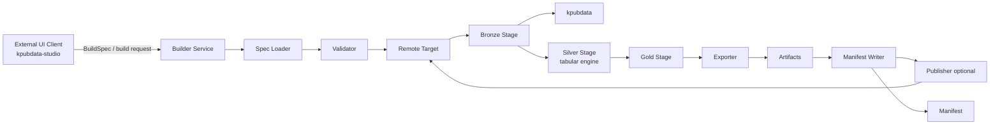

# 아키텍처 — KPubData Builder

## 1. 역할 정의

`kpubdata-builder`는 **재현 가능한 공공데이터 데이터셋 조립을 위한 Medallion 실행 엔진**입니다.

Builder의 핵심 역할은 다음과 같습니다.

- BuildSpec을 읽고 검증한다.
- `kpubdata`를 통해 Bronze source fetch를 위임한다.
- Bronze/Silver/Gold 단계를 오케스트레이션한다.
- Gold 결과를 exporter에 전달해 artifact를 만든다.
- 모든 실행을 manifest로 기록한다.
- 필요 시 publisher를 통해 외부 대상에 게시한다.

Builder는 다음을 하지 않습니다.

- provider별 API 접근 로직을 다시 구현하지 않습니다.
- Studio 같은 UI 계층의 화면 상태를 소유하지 않습니다.
- 임의의 범용 ETL 엔진이 되려고 하지 않습니다.

## 2. BuildSpec 중심 설계 원칙

이 시스템의 설계 중심은 **BuildSpec**입니다.

1. **BuildSpec이 실행의 단일 진실 공급원(single source of truth)** 입니다.
2. 실행 엔진은 spec을 해석하지만, 의미를 재정의하지 않습니다.
3. Bronze/Silver/Gold는 orchestrator가 관리하는 내부 실행 단계이며, exporter와 publisher는 Gold 결과를 소비하는 하위 단계입니다.
4. manifest는 실행 후 생성되는 기록물이지, 실행 규칙을 다시 정의하는 입력물이 아닙니다.
5. Studio나 다른 클라이언트는 BuildSpec을 작성·전송할 수 있지만, 계약 자체를 소유하지 않습니다.

## 3. 계층 분리

### 3.1 파이프라인 오케스트레이터

- BuildSpec 로딩/검증
- Bronze/Silver/Gold stage 전이 관리
- run workspace(`build/{run_id}/bronze/`, `silver/`, `gold/`) 관리

### 3.2 Bronze 단계

- `kpubdata` 호출로 원시 fetch 수행
- source snapshot 저장
- provenance logging 기록

### 3.3 Silver 단계

- Bronze snapshot을 표 형태로 정렬
- **단일 내부 tabular 엔진 DuckDB** 로 tabularize 수행([ADR 0021](https://github.com/kpubdata-lab/kpubdata-builder/blob/main/docs/adrs/0021-duckdb-tabular-engine.md), #864–#877). `src/` 는 Polars 를 import 하지 않는다(#876)
- schema validation, statistics, preview generation 수행

데이터는 다음 흐름으로 흐른다. 각 source 는 자기 DuckDB 연결 하나에서 Silver 와 Gold 를
SQL 로 만들고, 연결이 닫힌 뒤에도 읽히는 것은 Parquet 파일이다(파일 metadata 에 Builder
dtype 이 함께 기록된다).

```text
Bronze (file-backed JSONL)
        ↓  duckdb_load.load_records
DuckDB
        ↓  normalize · validate · summarize (SQL)
Silver relation  →  silver/table.parquet
        ↓  select · PII mask · split · compose (SQL)
Gold relation
        ↓
Parquet (gold/…/table.parquet, splits/)
```

질의(`/query`, warehouse rows·aggregate·profile·export)는 저장된 Parquet 을 잠긴 DuckDB
연결로 읽는 자식 프로세스에서 실행된다(#874).

### 3.4 Gold 단계

- Silver 결과를 split-ready package로 조립
- export-ready artifact 집합 준비
- exporter/publisher가 소비할 기준 패키지 생성

### 3.5 Exporter

- Gold package를 파일/레이아웃 artifact로 변환
- 로컬 파일 시스템 기준 결과물 생성
- source fetch나 stage promotion 정책은 직접 담당하지 않음

### 3.6 Publisher

- 이미 생성된 artifact를 원격 대상에 게시
- 게시 성공/실패를 실행 결과에 반영
- 파일 생성 책임은 없음

### 3.7 Manifest

- spec digest, 상태, artifact 목록, 실행 시각, 오류 요약 기록
- stage별 산출물과 승격 결과 기록 가능
- 성공/실패 여부와 무관하게 build run을 설명하는 감사 기록
- exporter/publisher를 대체하는 실행 단계가 아님

## 4. 외부 통합 지점

Builder는 외부와 다음 경계로 연결됩니다.

| 외부 시스템 | Builder가 받는 것 | Builder가 제공하는 것 |
| :--- | :--- | :--- |
| `kpubdata` | 정규화된 레코드 접근 | Bronze source 실행 위임 |
| 파일 시스템 | output 디렉터리 | artifact, manifest |
| 원격 게시 대상 | 게시 대상 설정/자격 증명 | 게시 요청 |
| `kpubdata-studio` | BuildSpec, 실행 요청 | 검증 결과, stage-aware preview, build 상태, manifest |

Studio는 여기서 **외부 UI 클라이언트**로만 동작합니다.

## 5. Medallion 파이프라인 흐름



```text
Studio/UI -> Builder Service -> Spec Loader -> Validator -> Pipeline Orchestrator
           -> Bronze(raw fetch) -> Silver(tabularize/validate) -> Gold(package)
           -> Exporter -> Artifacts -> Manifest Writer -> Publisher(optional)
```

## 6. 내부 책임 지도

| 단계 | 입력 | 출력 | 실패 시 영향 |
| :--- | :--- | :--- | :--- |
| Spec Loader | YAML/구조화된 spec | BuildSpec 객체 | build 시작 불가 |
| Validator | BuildSpec | 검증 결과 | `failed`로 종료 |
| Bronze 단계 | 검증된 BuildSpec | raw snapshot + provenance | Silver 이전에 중단 |
| Silver 단계 | Bronze snapshot | tabular relation + schema/stats/preview | Gold 이전에 중단 |
| Gold 단계 | Silver dataset | split-ready/export-ready package | export 이전에 중단 |
| Exporter | Gold package + export 설정 | artifact 목록 | publish 이전에 중단 |
| Manifest Writer | spec digest + 실행 결과 | manifest.json | 감사 기록 상실 위험 |
| Publisher | artifact + publish 설정 | 게시 결과 | artifact는 유지될 수 있음 |

## 7. 목표 디렉터리 구조

```text
src/kpubdata_builder/
├── pipeline/
│   └── orchestrator.py
├── stages/
│   ├── bronze/
│   ├── silver/
│   └── gold/
├── tabular/
│   └── duckdb_runtime.py · duckdb_load.py · sql.py · dtypes.py …   (ADR 0021)
├── exporters/
├── publishers/
├── spec.py
├── manifest.py
└── ...

build/{run_id}/
├── bronze/
├── silver/
└── gold/
```

위 구조의 핵심은 다음과 같습니다.

- stage 구현은 `stages/bronze`, `stages/silver`, `stages/gold`에 분리합니다.
- stage 흐름 제어는 `pipeline/orchestrator.py`가 담당합니다.
- tabular 처리는 **단일 엔진 DuckDB** 만 사용하며 dual-engine 전략은 두지 않습니다([ADR 0021](https://github.com/kpubdata-lab/kpubdata-builder/blob/main/docs/adrs/0021-duckdb-tabular-engine.md)). 이전 Polars 엔진은 테스트의 비교 기준(`tests/support/`, `tests/parity/`)으로만 남아 있고 production 코드에는 없습니다.
- run workspace는 `build/{run_id}/bronze/`, `silver/`, `gold/`로 고정해 재현성과 디버깅 가능성을 높입니다.

## 8. Builder-Studio 연결 원칙

- Studio는 BuildSpec을 **작성하고 전송**할 수 있지만, BuildSpec 계약을 정의하지 않습니다.
- Preview 계산은 Builder에서 수행되며 Studio는 stage-aware 결과를 렌더링합니다.
- Build 상태 머신은 Builder가 소유하며 Studio는 조회/표시만 합니다.
- Manifest 스키마는 Builder가 소유하며 Studio는 이를 소비합니다.

자세한 경계는 [BOUNDARY.md](./BOUNDARY.md)를 참고하세요.

## 9. 빌드 실행 경로 — 정식 vs 레거시 (#208)

코드베이스에는 두 실행 경로가 공존한다. 혼란을 막기 위해 **정식 경로를 다음과 같이
확정**한다.

### 9.1 정식 경로 — 메달리온 오케스트레이터

```
kpubdata_builder.pipeline.run_build(spec, client=..., output_root=..., run_id=...)
```

- 입력은 `BuildSpec`이며, 진입점에서 `validate_spec()`로 fail-fast 검증한다(#212).
- Bronze → Silver → Gold를 오케스트레이션하고, **단일** manifest 생성기
  (`kpubdata_builder.manifest`)로 스키마 버전·빌드 환경·입력 지문을 기록한다(#211).
- `kpubdata_builder.service`(HTTP)와 `kpubdata_builder.cli`가 모두 이 경로를 호출한다.
- **신규 기능과 버그 수정은 이 경로에만 추가한다.**

### 9.2 레거시 경로 — 스크립트 기반 publish 파이프라인

```
scripts/publish_to_hf.py  →  scripts/pipeline/{fetch,transform,package,publish}.py
```

- BuildSpec과 다른 자체 config 스키마(`scripts/configs/*.yaml`)를 쓰며, data.go.kr →
  HuggingFace/Kaggle 직접 publish(checkpoint/resume, variant, dataset card)를 담당한다.
- GitHub Actions `publish-dataset.yml` 및 스케줄 워크플로에 연결된 **프로덕션 경로**다.
- 해당 모듈에는 `DEPRECATED` 표시가 붙어 있으며, 프로덕션 호환을 위해서만 유지한다.
- 이 경로는 **레거시로서** 마지막 config 가 옮겨질 때까지 Polars 를 쓴다(`legacy-publish` extra)
  ([ADR 0021](https://github.com/kpubdata-lab/kpubdata-builder/blob/main/docs/adrs/0021-duckdb-tabular-engine.md) D1). 대기오염정보 게시는 멈춰 있다
  (`scheduled-air-quality.yml` 비활성, cron 줄도 제거, #759, #1244).

### 9.3 통합 계획

**결정: [ADR 0018](https://github.com/kpubdata-lab/kpubdata-builder/blob/main/docs/adrs/0018-legacy-publish-pipeline.md) 선택지 C** (소유자, 2026-09-30) — BuildSpec
의 빈 곳을 채우고 config 를 하나씩 옮긴다. 레거시 코드는 마지막 config 가 옮겨질 때까지
남고, 두 경로가 공존하는 동안 #688 의 게이트가 둘 다를 덮는다. 컬럼 선택과 행 필터는
Gold 에서 선언한다(#659 선택지 a) — Silver 는 컬럼을 모두 보존한다.

두 경로는 config 스키마가 근본적으로 다르고 레거시 경로가 프로덕션에 연결돼 있어 즉시
병합은 회귀 위험이 크다. 단계적 통합:

1. **(완료)** 정식 경로를 메달리온으로 확정하고 레거시 모듈 deprecate.
2. 레거시 config → `BuildSpec` 변환 어댑터 도입.
3. fetch/transform/package를 메달리온 stage 호출로 치환하고 publish만 publisher 계층에
   위임.
4. variant/checkpoint 등 publish 전용 기능을 메달리온에서 동등 제공한 뒤 스케줄
   워크플로를 새 진입점으로 전환하고 레거시 스크립트 제거.

각 단계는 publish 워크플로의 라이브 재검증을 동반한다.

## 10. 현재 실행 구조 (2026-10-07)

설계 문서와 ADR 은 결정이 내려진 순서대로 쌓여 있어서, "지금 어떻게 도는가" 를 한곳에서
읽기 어렵다. 이 절은 그 답만 적는다. 근거가 되는 결정은 괄호 안의 ADR 이다.

| | 지금 | 근거 |
|---|---|---|
| 프로세스 | **하나.** `serve` 가 스레드 풀로 HTTP 요청을 받고, 비동기 build 는 같은 프로세스의 워커 스레드에서 돈다. job 레지스트리·큐·job 에 묶인 키·동시 실행 상한이 프로세스 메모리에 있어 replica 를 늘릴 수 없다 | ADR 0008, [deploy.md §6](https://github.com/kpubdata-lab/kpubdata-builder/blob/main/docs/deploy.md) |
| 재시작·종료 | 대기·실행 중이던 job 은 이어지지 않는다. 종료 신호에는 대기 job 을 시작하지 않고 끝내고 실행 중인 것은 기다린다(#1118). 중단된 run 은 다음 기동 때 `failed` 로 표시된다 — 다중 사용자 배포는 `credentials_required` 로(#683), 단일 사용자 배포는 그 code 없이(#1120) | [deploy.md §7](https://github.com/kpubdata-lab/kpubdata-builder/blob/main/docs/deploy.md) |
| 인증 | 두 경로. 사람은 **OIDC access token**(`Authorization: Bearer`, Keycloak 등), 서비스 계정은 `X-API-Key`. `OIDC_ISSUER` 가 있으면 다중 사용자 배포다: 소유권이 강제되고 가입은 허용 목록이나 승인 원장으로만 열린다 | ADR 0006, 0015 (0009 를 대체), 0012 개정 |
| provider 키 | 다중 사용자 배포는 저장하지 않는다 — 요청마다 헤더로 받고 요청·작업 동안만 메모리에 둔다. 단일 사용자 배포는 암호화해 저장한다 | ADR 0020, [REQUEST_CREDENTIALS.md](https://github.com/kpubdata-lab/kpubdata-builder/blob/main/docs/REQUEST_CREDENTIALS.md) |
| build 경로 | 동기 `POST /build` 와 비동기 `POST /builds` 둘 다 있다. **업로드한 파일을 쓰는 build 도 비동기로 돈다**(#998) — ADR 0014 가 적은 "동기 경로만" 은 그때의 한계였다 | ADR 0002, 0008, 0014 보충 |
| 상태 저장 | 로컬 파일시스템 + SQLite(`BuildIndex`, 이벤트, 테이블 카탈로그 등)만. CUBRID 백엔드는 제거되었다 | ADR 0003, 0010, 0022 |
| tabular 엔진 | **전환 중.** 테이블 저장소·SQL·silver 정규화·품질 평가는 DuckDB 로 돌고, Polars 를 쓰는 모듈이 아직 남아 있다. 두 엔진을 함께 두는 것은 목표가 아니라 경과다 | ADR 0021 (제안됨), #876 |

이 표가 코드와 어긋나면 표가 틀린 것이다. ADR 은 결정의 기록이라 뒤에 달라진 것을 본문에서
지우지 않고 날짜를 붙여 덧붙인다([ADR 색인](https://github.com/kpubdata-lab/kpubdata-builder/blob/main/docs/adrs/README.md)의 작성 규칙) — 그래서 현재
상태는 ADR 한 편이 아니라 이 절을 본다.

## 11. 관련 문서

| 문서 | 설명 |
| :--- | :--- |
| [BUILD_SPEC.md](./BUILD_SPEC.md) | BuildSpec 계약 |
| [API_CONTRACT.md](./API_CONTRACT.md) | Builder 중심 API 계약 |
| [BUILD_STATE.md](./BUILD_STATE.md) | 빌드 상태 머신 |
| [ALGORITHM.md](./ALGORITHM.md) | 전체 빌드 알고리즘 명세 |
| [BOUNDARY.md](./BOUNDARY.md) | Builder-Studio 경계 |
| [ROADMAP.md](./ROADMAP.md) | 향후 확장 계획 |


## 12. 안정화 기간의 점진적 구조 개선

기존 `kpubdata-builder` 제품과 설치·실행 계약을 유지한다. 새로운 실행 제품으로
전체를 다시 작성하거나, 다른 데이터베이스를 지원하기 위해 기존 경로를 일괄
추상화하지 않는다. 구조 변경은 확인된 결합도·중복 정책·회귀 위험을 줄이는
작은 단위로 진행하고, 변경 전후 결과를 테스트로 비교한다.

### 12.1 실행 진입점과 공유 계약

- CLI는 명령행 입력·종료 코드·콘솔 출력, HTTP는 인증·요청 범위의 권한·응답
  포맷과 실행 제어를 담당한다. Python 직접 호출은 기존
  `kpubdata_builder.pipeline.run_build` 경로를 사용한다.
- 진입점의 응답 형태까지 같게 만들지 않는다. 대신 BuildSpec의 해석·검증,
  빌드 산출물, Manifest, 재현성 규칙 같은 공통 의미가 어긋나지 않아야 한다.
- `validate`의 Python·CLI·HTTP 수락/거부 결과는 동일한 BuildSpec으로
  비교한다(`tests/integration/test_validation_entrypoint_parity.py`).
- CLI와 HTTP의 인증·소유권·작업 큐·게시 정책은 의도적으로 다를 수 있다.
  이들을 무리하게 공통 서비스로 합치기 전에 차이와 보안 경계를 명시한다.
- `BuilderService`의 대규모 위임 구조 변경과 동기 빌드 구현 변경은
  #1242의 미결정 범위를 먼저 확정한 뒤 별도 테스트와 함께 진행한다.

### 12.2 저장·처리 기술의 경계

- 기본 데이터 처리·SQL 조회 구현은 DuckDB이며, SQLite는 운영 상태와
  테이블 카탈로그, Parquet/Manifest는 재현 가능한 산출물을 담당한다.
  각 기술의 역할을 혼합하지 않는다.
- 처리 기술을 바꿀 때는 BuildSpec 의미, 정규 타입, 정렬·NULL 처리,
  스냅샷 및 저장된 SQL의 방언·엔진 버전을 명시적으로 검증한다.
  단순히 다른 DB 드라이버로 교체하면 호환된다고 가정하지 않는다.
- 기존 `SourceClient`, `BuildIndex`, `ArtifactStore` 등의 경계를 활용한다.
  아직 요구되지 않은 데이터베이스 백엔드, 범용 처리 엔진 어댑터 또는
  SQLAlchemy 의존성을 미리 도입하지 않는다.
- 여러 프로세스로 확장하려면 SQLite 교체뿐 아니라 현재 프로세스 내부의
  작업 큐·실행 상태와 파일 저장의 일관성까지 별도로 설계해야 한다.

### 12.3 변경의 완료 기준

1. 기존 SDK 입력부터 BuildSpec·Gold·Manifest·조회까지 주요 경로에서
   동작 보존을 확인한다. 진입점별로 의도된 정책 차이도 테스트로 고정한다.
2. 실행 상태, 취소, 품질, 개인정보 보호, 이용조건, 스냅샷 승격과 게시의
   실패·복구 의미를 유지한다.
3. 새 외부 의존성이나 운영 책임이 생기는 변경은 실제 필요성과
   검증 근거를 먼저 기록하고, 제품군 안정화 정책의 별도 심사를 따른다.

이 절은 기존 Architecture Decision Record를 대체하지 않으며, 과거 결정과
현재 코드가 다를 때는 최신 코드와 승인된 변경 기록을 우선 확인한다.
